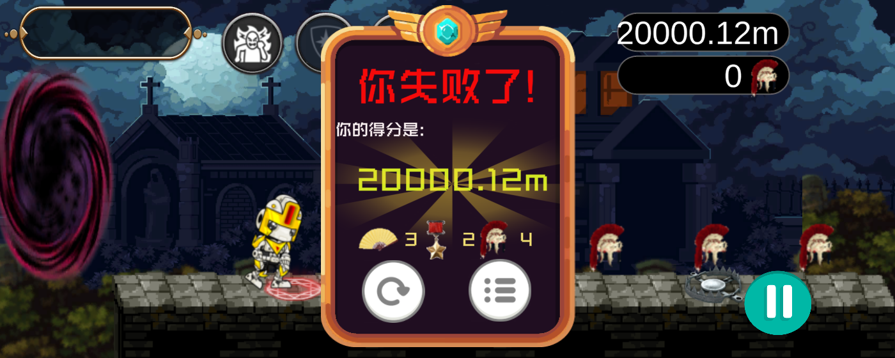

# 时空之门

在黑洞的追逐下奔跑，收集战利品，穿过连接不同时代的传送门。

**[下载 Windows 64 位版 · STP.zip](https://github.com/RiT-SS/STP/releases/latest/download/STP.zip)** · [查看发布页](https://github.com/RiT-SS/STP/releases/latest)


## 开始游玩

下载并完整解压 `STP.zip`，进入文件夹，双击 **时空之门.exe**。无需安装 Unity，请保留 exe 旁的全部文件和目录。

默认窗口为 **1400×560**。窗口可以调整大小，游戏画面保持 **5:2** 比例，多出的区域显示黑边。

## 三个时代，三种战利品

每局先经过 **古代 → 战争 → 中世纪**，之后在另外两个时代中随机选择下一站。平台的样式和高度也会随机变化。

### 古代：在楼阁之间起跑

收集扇子，越过断开的平台与敌人。左上角显示生命和技能状态，右上角显示距离与本关收集进度。


### 战争：收集勋章，寻找下一道门

传送需求从 **10 个**开始，每经过一张地图增加 **2 个**，依次为 **10、12、14、16……**。达到需求后，后续生成的平台上会出现可进入的传送门。

右上角显示“本关已收集 / 本关需求”。例如下图的 **12/12** 表示本关已经达标。显示达到上限后，额外收集的战利品仍会计入本局总数。


### 中世纪：月夜、头盔与陷阱

进入月夜中的城堡街道，收集头盔，留意沿路的敌人、捕兽夹和高低平台。每次换场，本关收集数重新计算，整局战利品继续累计。


## 选择角色

| 探险家 爱丽丝 | 盗贼 燕子 | 机器人 伯特 |
| :---: | :---: | :---: |
|  |  |  |
| 遭遇致命伤害时自动复活，恢复至 **1 颗心**，冷却 **30 秒**。 | 下落时按住 **W / ↑** 可以滑翔，放缓下降速度。 | 按 **A** 开启冲刺，持续 **3 秒**，冷却 **20 秒**。冲刺期间无敌，并随平台高度移动。 |

爱丽丝会随复活特效移动回跑道，随后恢复行动。切换场景时，角色技能和道具状态会重置。


## 黑洞与道具

身后的黑洞会吞噬地形。地板和非生物障碍会裂成碎片，被逐渐吸入；生物障碍保持整体消失。跑得更远，也要留意脚下的空隙。


既有道具位置有 **25%** 的概率刷新道具。护盾提供短暂保护，磁体吸引附近的道具与战利品，两者持续时间均为 **5 秒**；生命道具可以补充一颗心。


## 结算与游戏记录

每局战利品从零开始计算。结算会显示整局距离，以及扇子、勋章和头盔三类战利品的数量。



“游戏记录”保存每局的开始时间、所选角色、距离和三类战利品数量。按**距离从长到短、同距离时开始时间从新到旧**排序，最多保留 **20 条**，可以滚动查看。

下载包不附带开发者的历史记录，第一次打开时列表为空；后续记录保存在游戏目录中的 `SaveData` 文件夹。


## 操作

| 按键 | 功能 |
| --- | --- |
| W / ↑ | 跳跃、二段跳；盗贼下落时按住可滑翔 |
| S / ↓ | 滑铲、加速下落 |
| A | 机器人冲刺 |
| Esc | 暂停 / 继续；关闭记录页 |
| R | 重新开始 |

截图选自开发过程中的实机画面，技能时长与冷却以本文的当前版本数值为准。

<details>
<summary><strong>源码工程与编译方法</strong></summary>

本仓库保存作者从编译版本恢复、并持续修改的 Unity 可编辑工程。

### 在 Unity 中打开

- Unity 版本：**2021.3.21f1c1（中国版）**。
- 在 Unity Hub 中添加仓库根目录，等待首次资源导入完成。
- 打开 `Assets/Scenes/StartMenu.unity`，点击播放按钮。

### 编译 Windows 64 位发行版

使用对应 Unity 编辑器，传入以下参数：

```text
-batchmode -quit -projectPath <工程目录> -executeMethod BuildPlayableRelease.Run -releasePath <新的输出目录>
```

输出目录需要尚不存在。构建会包含五个场景和仓库根目录中的 `游玩说明.txt`；分享发行包时应排除个人的 `SaveData` 目录。

| 目录 | 内容 |
| --- | --- |
| `Assets/Scenes` | 主菜单、选人界面与三个游戏场景 |
| `Assets/Scripts/Assembly-CSharp` | 游戏逻辑 |
| `Assets/Editor` | 构建、编辑器辅助与验证工具 |
| `Assets` 其余目录 | 图片、音频、字体、动画、预制体等资源 |
| `Packages` / `ProjectSettings` | 依赖和项目配置 |
| `docs/screenshots` | README 使用的实机截图 |

完整资源及 `.meta` 文件均纳入版本管理。缓存、日志、个人游玩记录和编译产物不进入源码仓库；可运行版通过 [Releases](https://github.com/RiT-SS/STP/releases) 提供下载。

</details>
