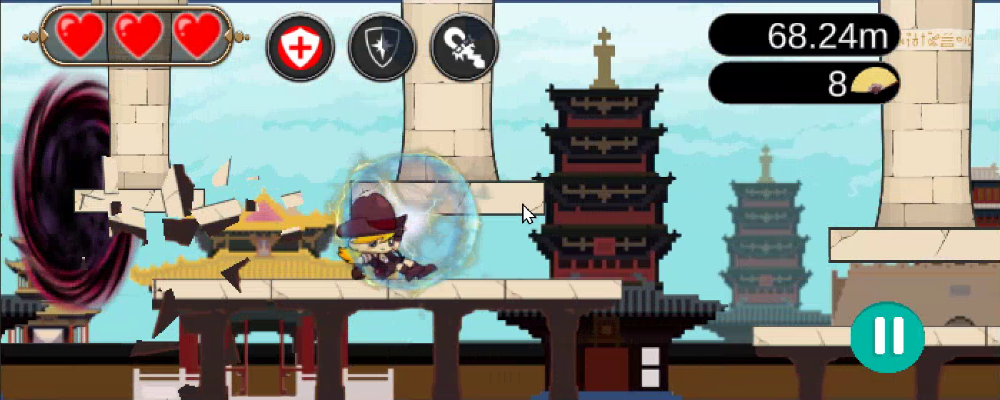
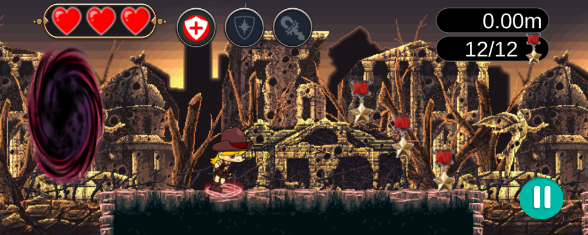
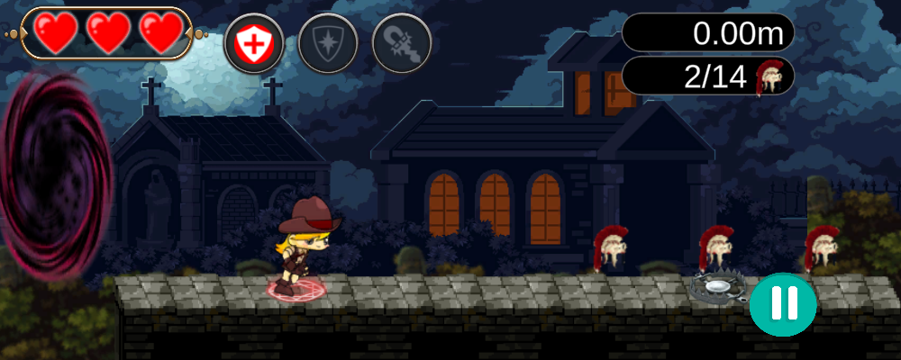
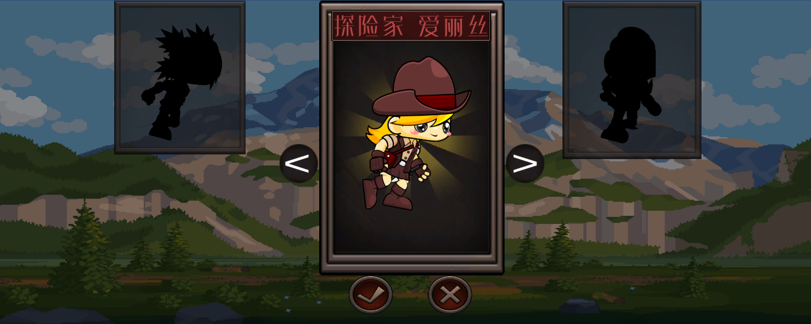
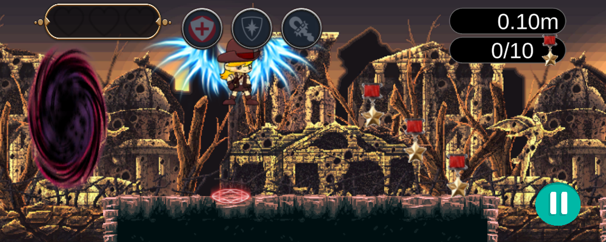
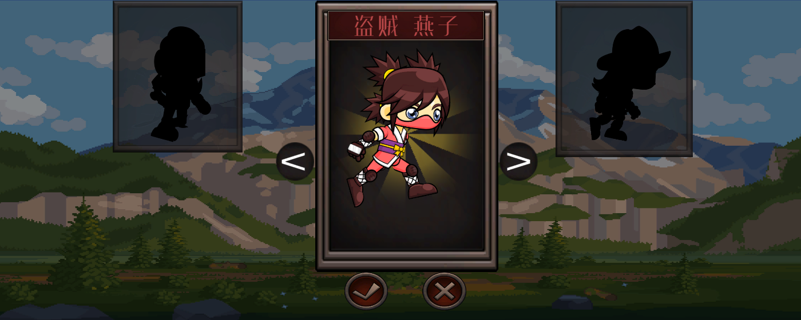
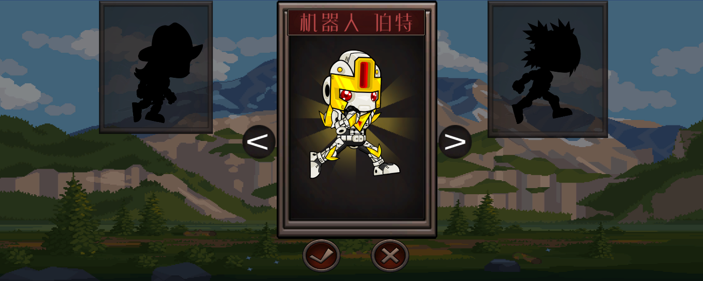
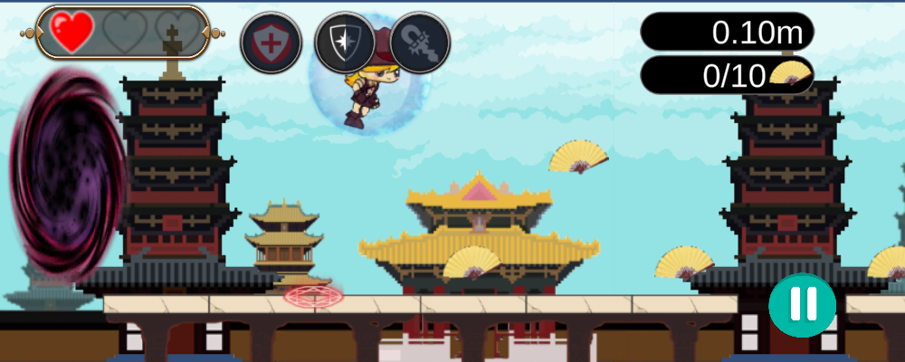
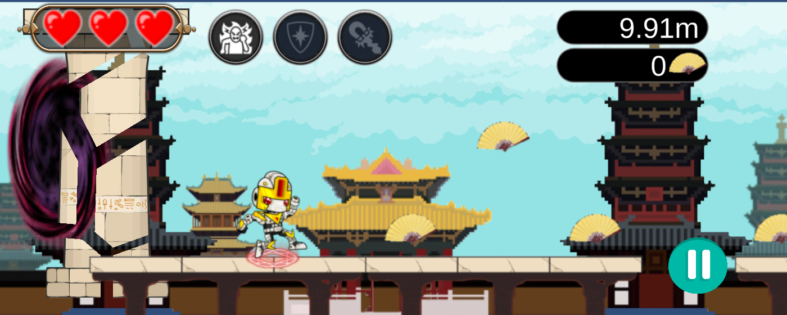
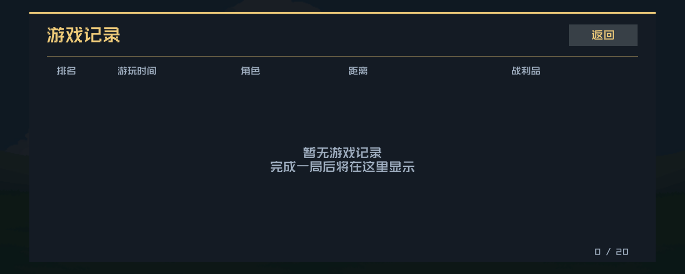

# 时空之门

小白做的第一个较为完整的跑酷类小游戏。游戏整体略显粗糙，仅供图一乐。

玩法很直接：逃离黑洞，收集足够的战利品以进行场景切换。目标自然是生存得越久越好。

**[下载 Windows 64 位版 · STP.zip](https://github.com/RiT-SS/STP/releases/latest/download/STP.zip)** · [查看发布页](https://github.com/RiT-SS/STP/releases/latest)

  

## 开始游玩

下载并解压 `STP.zip`，运行 **时空之门.exe** 即可游玩。

## 游戏场景

### 场景一

  

### 场景二

  

### 场景三

  

## 可选角色

### 探险家 爱丽丝

遭遇致命伤害时自动复活，恢复至 **1 颗心**，冷却 **30 秒**。

  

  

### 盗贼 燕子

下落时按住 **W / ↑** 可以缓降。

  

### 机器人 伯特

按 **A** 开启冲刺，持续 **3 秒**，冷却 **20 秒**。冲刺期间无敌，并自动跟随平台高度前进。

  

切换场景时，角色技能和道具状态会重置。

## 道具

道具以较低的概率在地图随机出现，各类道具效果如下：

| 道具 | 效果 |
| --- | --- |
| 护盾 | 提供短暂保护，持续 **5 秒** |
| 磁铁 | 吸引附近的道具与战利品，持续 **5 秒** |
| 生命 | 补充 **1 颗心** |

  

## 操作方式

| 按键 | 功能 |
| --- | --- |
| W / ↑ | 跳跃、二段跳；盗贼下落时按住可缓降 |
| S / ↓ | 滑铲、加速下落 |
| A | 机器人冲刺 |
| Esc | 暂停 / 继续；关闭记录页 |
| R | 重新开始 |

## 游戏背景

本来是想围绕“黑洞”做文章的，但是游戏质量……等以后真正做出那种能让人“时不时想玩两把”的游戏时，再在剧情上下功夫吧。

### 黑洞

  

### 排行榜

  

